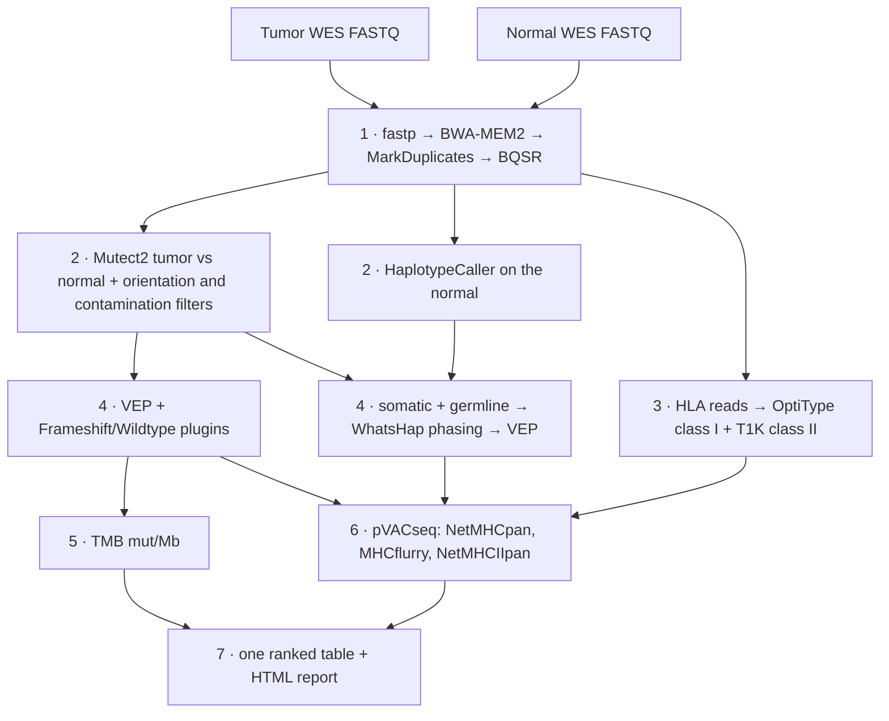

# neoantigen-pipeline

[](https://github.com/kashyapshilpi/Neoantigen-pipeline/actions/workflows/ci.yml)
[](https://pvactools.readthedocs.io/)
[](LICENSE)

A bash pipeline that takes **tumor/normal whole-exome sequencing** to a **ranked list of MHC class I and
class II neoantigen candidates**. Along the way it calls somatic and germline variants, measures
**tumor mutational burden (TMB)**, types **HLA class I and II** from the germline sample, builds the
**pVACseq input** (VEP annotation and phased proximal variants) and runs **pVACseq** for both MHC classes.

The pipeline is one command, resumes where it stopped, and every line of code has a comment
explaining why it is there.

## Workflow



| Step | Script | Tools | Output |
|---|---|---|---|
| 1 | `scripts/01_preprocess.sh` | fastp, BWA-MEM2, GATK MarkDuplicates, BQSR | `<sample>/bam/<sample>.final.bam` |
| 2 | `scripts/02_variants.sh` | GATK Mutect2, LearnReadOrientationModel, CalculateContamination, FilterMutectCalls, bcftools norm, HaplotypeCaller | `<patient>/variants/` somatic PASS + germline VCFs |
| 3 | `scripts/03_hla.sh` | samtools, OptiType, T1K, `bin/hla_merge.awk` | `<patient>/hla/<patient>.hla.txt` |
| 4 | `scripts/04_annotate_phase.sh` | Ensembl VEP (Frameshift, Wildtype), bcftools, WhatsHap | `<patient>/pvacseq_input/` |
| 5 | `scripts/05_tmb.sh` | bcftools +split-vep, `bin/tmb.awk` | `<patient>/tmb/` TMB and the variants counted |
| 6 | `scripts/06_pvacseq.sh` | pVACseq 7.1.5 (Docker) | `<patient>/pvacseq/MHC_Class_I`, `MHC_Class_II` |
| 7 | `scripts/07_rank_report.sh` | `bin/rank.sh` | `<patient>/report/` ranked TSV + HTML report |

## Install (once)

```bash
conda env create -f environment.yml && conda activate neoantigen   # all command-line tools
docker pull griffithlab/pvactools:7.1.5                            # pVACseq + IEDB prediction tools
```

Reference files (set their paths in `config.sh`):
- GRCh38 FASTA with `.fai`, `.dict` and a `bwa-mem2 index`
- exome capture BED (`TARGETS`)
- VEP cache, version 113 (`vep_install -a cf -s homo_sapiens -y GRCh38 -c <dir>`)
- `Frameshift.pm` and `Wildtype.pm` VEP plugins (`pvacseq install_vep_plugin <dir>`)
- T1K HLA reference (`t1k-build.pl -o hlaidx --download IPD-IMGT/HLA`)
- optional, recommended: GATK resource bundle `af-only-gnomad`, `1000g_pon`, `small_exac_common_3`, dbSNP, Mills

## Run

```bash
bash run_all.sh samplesheet.csv
```

Run the same command again after a failure: finished steps are skipped (`results/.done/`), and each
step's log is in `results/logs/`.

### Samplesheet

One tumor and one normal row per patient ([example](samplesheet.example.csv)):

```csv
patient,sample_type,fastq_1,fastq_2,hla_alleles
PT001,normal,/data/PT001_N_R1.fastq.gz,/data/PT001_N_R2.fastq.gz,
PT001,tumor,/data/PT001_T_R1.fastq.gz,/data/PT001_T_R2.fastq.gz,
```

`hla_alleles` is optional. If clinical HLA typing is available, enter it there, separated by `;`. It
replaces the computed alleles of the same class.

## How candidates are ranked

Class I and class II results for the same variant are joined into one row and sorted by:

1. **best pVACseq tier** (Pass, Anchor, Subclonal, LowExpr, NoExpr, Poor)
2. **good in both classes** (Pass or Anchor for class I *and* class II): CD8 and CD4 T cells can both respond
3. **lowest IC50** (strongest predicted binding; class I first, because its scale is better calibrated)
4. **highest tumor DNA VAF** (more tumor cells carry the mutation)

## TMB

Somatic PASS variants with a protein-changing consequence (missense, frameshift, stop gained or lost,
start lost, in-frame indel), tumor depth ≥ 20, ≥ 4 alt reads, VAF ≥ 5 % and normal VAF ≤ 2 %, divided
by the merged size of the capture BED in Mb. ≥ 10 mut/Mb is reported as TMB-high. All cut-offs are in
`config.sh`.

## Testing

```bash
bash test/run_tests.sh   # HLA merging, TMB and ranking on small made-up inputs
bash test/dry_run.sh     # the whole pipeline with pretend tools: checks every hand-over, resume and the report
```

Both run on every push through GitHub Actions, together with `bash -n` and ShellCheck. The dry run
checks the plumbing, not the science: a real run needs the tools and reference files above. The
public HCC1395 tumor/normal WES (used in the pVACtools tutorials) is a good first real dataset.

## Notes and limits

- **Phasing:** the pVACseq manual uses GATK3 ReadBackedPhasing, which is discontinued; WhatsHap does the same job.
- **No RNA yet:** without expression data, pVACseq's expression-based tiers (LowExpr, NoExpr) are not applied.
- **HLA from the normal sample:** the tumor can lose HLA alleles, so the germline sample gives the true type.

## Background

This reproduces the neoantigen workflow I ran on clinical WES, rebuilt from scratch on public tools:
germline and somatic calling, TMB, HLA typing from the germline sample, pVACseq input preparation,
class I and class II prediction, and ranking.

## Citations and license

Please cite the tools this pipeline runs: see [CITATIONS.md](CITATIONS.md). License: MIT, see [LICENSE](LICENSE).
